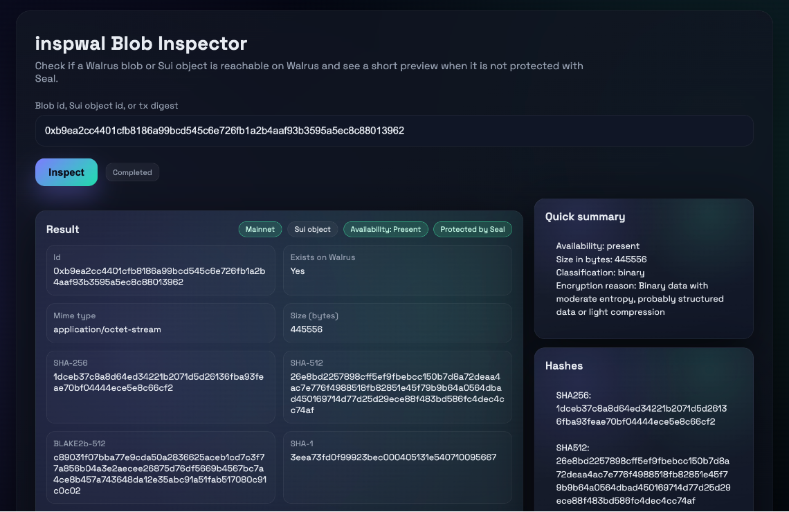

# inspwal

Inspector for Walrus blobs and Sui objects. Paste a Walrus blob id or a Sui object id and see whether the blob is reachable, what kind of content it holds, whether it is encrypted with Seal, and the related Sui object and certifying transaction.



## What it shows

- **Availability:** whether the blob exists on Walrus, and on which network (mainnet or testnet).
- **Content:** MIME type, size, detected file format, entropy and compression estimates, and SHA-256, SHA-512, BLAKE2b-512, SHA-1 and MD5 hashes.
- **Preview:** a short text or media preview when the content is not protected.
- **Seal:** detection of Seal-encrypted objects with the official `@mysten/seal` SDK, including the threshold and the key servers.
- **Sui data:** the related `blob::Blob` object and the transaction that certified it.

## How it works

The front end is a single static page in `public/`. The back end is a small Express server that talks to Walrus aggregators and Sui fullnodes. The page tries mainnet first and falls back to testnet.

There are two servers:

| Server | Finds the Sui object of a blob id through | API key |
|---|---|---|
| `server.js` | a local index, `indexer/blob_index.json` | not needed |
| `server-Blockberry.js` | the Blockberry API, at request time | `BLOCKBERRY_API_KEY` |

## Quick start

Requires Node.js 18 or later.

```bash
npm install
cp .env.example .env
npm start
```

Then open http://localhost:3001.

To use the Blockberry server instead, add a key from [api.blockberry.one](https://api.blockberry.one/) to `.env` and run:

```bash
npm run start:blockberry
```

## The local index

`indexer/run.js` reads `BlobCertified` events from a Sui fullnode and writes `indexer/blob_index.json`. The index maps each blob id (in decimal) to its Sui object id, with its storage epochs and certifying transaction. The repository includes a snapshot from November 2025. Blobs certified after that need a rebuilt index or the Blockberry server.

To rebuild the index:

```bash
npm run index
```

## Configuration

All settings live in `.env`. See [`.env.example`](.env.example).

| Variable | Used by | Purpose |
|---|---|---|
| `PORT` | both servers | HTTP port, default 3001 |
| `WALRUS_MAINNET_URL`, `WALRUS_TESTNET_URL` | both servers | Walrus aggregators |
| `SUI_RPC_MAINNET`, `SUI_RPC_TESTNET` | both servers | Sui fullnodes |
| `SUI_RPC` | indexer | Sui fullnode for the index build, default mainnet |
| `BLOCKBERRY_API_KEY` | `server-Blockberry.js` | Blockberry access |
